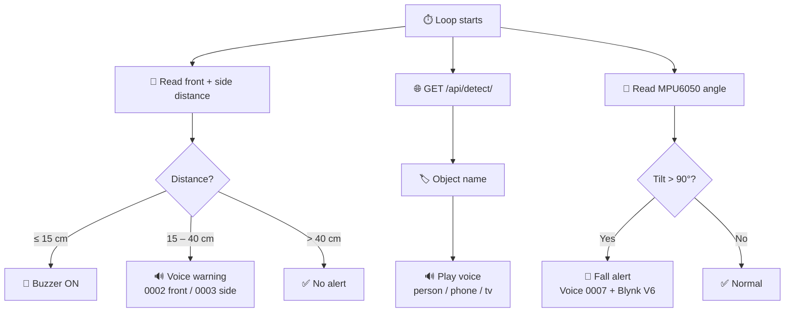

<div align="center">

# 🦯 Smart Blind Navigation System

### *An IoT + AI assistive device that helps visually impaired people move safely and independently*


<br>


<br><br>

**🚧 Obstacle Detection &nbsp;•&nbsp; 🤖 AI Object Recognition &nbsp;•&nbsp; 🚨 Fall Detection &nbsp;•&nbsp; 📍 Live GPS &nbsp;•&nbsp; 🔊 Voice Alerts &nbsp;•&nbsp; 📱 Remote Monitoring**

</div>

---

## 📑 Table of Contents

- [🎥 Demo Video](#-demo-video)
- [📖 About the Project](#-about-the-project)
- [✨ Key Features](#-key-features)
- [🏗️ System Architecture](#️-system-architecture)
- [🧰 Hardware Requirements](#-hardware-requirements)
- [🔌 Pin Connections](#-pin-connections)
- [💻 Software Requirements](#-software-requirements)
- [🔊 Voice Files](#-voice-files-dfplayer)
- [📱 Blynk Dashboard Setup](#-blynk-dashboard-setup)
- [🚀 Installation Guide](#-installation-guide)
- [⚙️ How It Works](#️-how-it-works)
- [🔗 API Contract](#-api-contract)
- [📁 Project Structure](#-project-structure)
- [🛠️ Troubleshooting](#️-troubleshooting)
- [🔐 Security Note](#-security-note)
- [🔮 Future Improvements](#-future-improvements)
- [👤 Author](#-author)

---

## 🎥 Demo Video

<div align="center">

> 👇 **Click the image to watch the full working demo**

<a href="https://drive.google.com/file/d/13ZLQHstsLv5ax7DYjMHhBMooee33j60B/view?usp=sharing">
</a>

<br>

[](https://drive.google.com/file/d/13ZLQHstsLv5ax7DYjMHhBMooee33j60B/view?usp=sharing)

</div>

---

## 📖 About the Project

Walking in unfamiliar places is risky for visually impaired people. This project is a **wearable / walking-stick assistant** that:

- 👀 **Sees** the surroundings with ultrasonic sensors and an AI camera
- 🗣️ **Speaks** warnings and object names through a speaker
- 🔔 **Alarms** instantly when something is dangerously close
- 🆘 **Detects falls** and alerts the caregiver
- 🌍 **Shares live location** so family can track the user

A caregiver can monitor everything remotely from the **Blynk** mobile / web dashboard.

---

## ✨ Key Features

| | Feature | Description |
|:-:|---|---|
| 🚧 | **Obstacle Detection** | Two HC-SR04 ultrasonic sensors (front + side) measure distance every second |
| 🔔 | **Buzzer Alert** | Continuous buzzer when an obstacle is **≤ 15 cm** |
| 🔊 | **Voice Warning** | Spoken front / side warning when obstacle is **15 – 40 cm** away (DFPlayer Mini) |
| 📷 | **AI Object Detection** | ESP32-S3 camera uploads images to a Django AI server; detected objects (`person`, `cell phone`, `tv`) are announced by voice |
| 🚨 | **Fall Detection** | MPU6050 tilt angle **> 90°** triggers a fall alert (voice + Blynk) |
| 📍 | **GPS Tracking** | Live latitude / longitude pushed to Blynk every ~32 seconds |
| 📱 | **Remote Monitoring** | Blynk dashboard shows distances, location, detected object, tilt, fall status and Wi-Fi status |

### 🚦 Alert Zones

| Zone | Distance | Response |
|:-:|:-:|---|
| 🔴 **Danger** | ≤ 15 cm | 🔔 Continuous buzzer |
| 🟡 **Warning** | 15 – 40 cm | 🔊 Voice warning (once per entry) |
| 🟢 **Safe** | > 40 cm | ✅ No alert |

---

## 🏗️ System Architecture

The project has **two microcontrollers + one AI server + a cloud dashboard**.

```mermaid
flowchart LR
    subgraph CAM["📷 Camera Unit - ESP32-S3"]
        C1["OV2640 Camera<br/>QVGA JPEG"]
    end

    subgraph SRV["🧠 AI Server - Django"]
        S1["POST /api/detect/<br/>Object Detection Model"]
    end

    subgraph MAIN["🎛️ Main Controller - ESP32"]
        M1["HC-SR04 x2<br/>Front + Side"]
        M2["MPU6050<br/>Fall Detection"]
        M3["NEO-6M GPS"]
        M4["DFPlayer Mini<br/>+ Speaker"]
        M5["Buzzer"]
    end

    subgraph CLOUD["☁️ Blynk Cloud"]
        B1["📱 Caregiver<br/>Dashboard"]
    end

    C1 -- "Image every 1.5 s<br/>multipart POST" --> S1
    S1 -- "JSON detections<br/>HTTP GET every 1.2 s" --> MAIN
    MAIN -- "Wi-Fi: distance, GPS,<br/>object, tilt, fall" --> B1
```



| # | Unit | Role |
|:-:|---|---|
| 1️⃣ | **Main Controller** (ESP32) | Reads sensors, plays alerts, talks to Blynk, fetches the latest detection result |
| 2️⃣ | **Camera Module** (ESP32-S3) | Captures an image every **1.5 s** and uploads it to the AI server |
| 3️⃣ | **AI Server** (Django, `ai_server/`) | Receives images, runs object detection, returns JSON |

---

## 🧰 Hardware Requirements

### 🎛️ A) Main Controller Unit

| # | Component | Qty | Purpose |
|:-:|---|:-:|---|
| 1 | ESP32 DevKit (30/38-pin, ESP32-WROOM-32) | 1 | Main brain + Wi-Fi |
| 2 | HC-SR04 ultrasonic sensor | 2 | Front & side obstacle distance |
| 3 | MPU6050 (GY-521) gyro / accelerometer | 1 | Fall / tilt detection |
| 4 | NEO-6M GPS module (with antenna) | 1 | Live location |
| 5 | DFPlayer Mini MP3 module | 1 | Voice alerts |
| 6 | microSD card (FAT32, ≤ 32 GB) | 1 | Stores voice files |
| 7 | Speaker 3W (4Ω / 8Ω) or earphone | 1 | Audio output |
| 8 | Active buzzer (5 V) | 1 | Close-range alarm |
| 9 | 1 kΩ resistor | 1 | DFPlayer RX line protection |
| 10 | Voltage divider resistors (1 kΩ + 2 kΩ) | 2 sets | Level-shift HC-SR04 ECHO (5 V → 3.3 V) |
| 11 | 18650 Li-ion + TP4056 + 5 V boost converter (or 5 V power bank) | 1 | Portable power |
| 12 | Breadboard / perfboard, jumper wires, switch | – | Wiring |

### 📷 B) Camera Unit

| # | Component | Qty | Purpose |
|:-:|---|:-:|---|
| 1 | ESP32-S3 camera board with **PSRAM** (OV2640 / OV5640) | 1 | Image capture + upload |
| 2 | USB-C cable / 5 V supply | 1 | Power & flashing |

> 📌 The camera sketch uses: `XCLK=15`, `SIOD=4`, `SIOC=5`, `Y2–Y9 = 11, 9, 8, 10, 12, 18, 17, 16`, `VSYNC=6`, `HREF=7`, `PCLK=13`.
> If your board has a different pin map, update those `#define`s in `Smart_Blind_Camera.ino`.

### 🌐 C) Server / Network

| Item | Notes |
|---|---|
| 💻 PC / laptop / mini server | Runs the Django AI server (GPU optional, but faster) |
| 📶 Wi-Fi router or phone hotspot (**2.4 GHz**) | ESP32 boards, server PC and phone must reach each other |

---

## 🔌 Pin Connections

**Main ESP32 wiring:**

| Module | Module Pin | ESP32 Pin |
|---|---|:-:|
| 🚧 Ultrasonic **FRONT** | TRIG | `GPIO 17` |
| | ECHO *(via divider)* | `GPIO 16` |
| 🚧 Ultrasonic **SIDE** | TRIG | `GPIO 5` |
| | ECHO *(via divider)* | `GPIO 18` |
| 🔔 Buzzer | + | `GPIO 25` |
| 🧭 MPU6050 | SDA | `GPIO 21` |
| | SCL | `GPIO 22` |
| 📍 GPS NEO-6M | TX → | `GPIO 32` (ESP32 RX2) |
| | RX ← | `GPIO 33` (ESP32 TX2) |
| 🔊 DFPlayer Mini | TX → | `GPIO 26` (ESP32 RX) |
| | RX ← *(via 1 kΩ)* | `GPIO 27` (ESP32 TX) |
| ⚡ Power | VCC / GND | 5 V → HC-SR04, DFPlayer, buzzer &nbsp;\|&nbsp; 3.3 V → MPU6050, GPS &nbsp;\|&nbsp; common GND |

> ⚠️ **Warning:** HC-SR04 ECHO outputs **5 V**. Use a voltage divider (1 kΩ + 2 kΩ) before connecting it to an ESP32 GPIO, or use HC-SR04P / 3.3 V-compatible sensors.

---

## 💻 Software Requirements

### 🛠️ Arduino IDE

- **Arduino IDE 2.x**
- **ESP32 board package** by Espressif (Boards Manager)
  - Main unit board: `ESP32 Dev Module`
  - Camera unit board: `ESP32S3 Dev Module` (enable **PSRAM: OPI PSRAM** if supported by your board)

### 📚 Arduino Libraries

| Library | Used for |
|---|---|
| `Blynk` (BlynkSimpleEsp32) | IoT dashboard |
| `MPU6050_light` | Gyro / angle reading |
| `TinyGPSPlus` | GPS NMEA parsing |
| `DFRobotDFPlayerMini` | Voice playback |
| `ArduinoJson` (v6.x) | Parse API response |
| `WiFi`, `HTTPClient`, `Wire`, `HardwareSerial` | Built into ESP32 core |
| `esp_camera` | Built into ESP32 core (camera unit) |

### 🧠 AI Server (`ai_server/`)

- Python **3.9+**
- **Django** (REST endpoint `/api/detect/`)
- An object detection model (COCO-style labels such as `person`, `cell phone`, `tv`)
- `pip` packages from the server's requirements (see `ai_server/`)

### 📱 Mobile App

- **Blynk IoT** app (Android / iOS) or the Blynk web dashboard

---

## 🔊 Voice Files (DFPlayer)

Format the microSD card as **FAT32** and copy the MP3 files to the **root**, named exactly:

| File | 🎙️ Played when |
|:-:|---|
| `0001.mp3` | ✅ Wi-Fi connected / system ready |
| `0002.mp3` | 🚧 Obstacle in **front** (15–40 cm) |
| `0003.mp3` | 🚧 Obstacle on the **side** (15–40 cm) |
| `0004.mp3` | 🧍 **Person** detected |
| `0005.mp3` | 📱 **Cell phone** detected |
| `0006.mp3` | 📺 **TV** detected |
| `0007.mp3` | 🚨 **Fall** detected |

---

## 📱 Blynk Dashboard Setup

1. Create an account at [blynk.cloud](https://blynk.cloud) and make a **Template** (e.g. `smart blind navigation system`, hardware: **ESP32**, connection: **Wi-Fi**).
2. Add these **Datastreams** and widgets:

| Virtual Pin | Data | Suggested Widget |
|:-:|---|---|
| `V0` | Front distance (cm) | 📏 Gauge |
| `V1` | Side distance (cm) | 📏 Gauge |
| `V2` | GPS latitude | 📍 Value / Map |
| `V3` | GPS longitude | 📍 Value / Map |
| `V6` | Fall alert (0 / 1) | 🚨 LED / Notification |
| `V7` | Detected object (string) | 🏷️ Label |
| `V8` | Tilt angle X | 📐 Value display |
| `V9` | Tilt angle Y | 📐 Value display |
| `V10` | Wi-Fi / API status (0 / 1) | 🟢 LED |

3. Create a **Device** from the template and copy its `BLYNK_TEMPLATE_ID`, `BLYNK_TEMPLATE_NAME` and `BLYNK_AUTH_TOKEN`.

---

## 🚀 Installation Guide

### 1️⃣ Clone the repository

```bash
git clone https://github.com/shorafothoshen/Smart_Blind_Navigation_System.git
cd Smart_Blind_Navigation_System
```

### 2️⃣ Start the AI server

```bash
cd ai_server
python -m venv venv
source venv/bin/activate          # Windows: venv\Scripts\activate
pip install -r requirements.txt   # if provided
python manage.py migrate
python manage.py runserver 0.0.0.0:8000
```

Find your PC's local IP (`ipconfig` / `ifconfig`), e.g. `192.168.0.10`.
The API will be available at `http://192.168.0.10:8000/api/detect/`.

### 3️⃣ Configure & upload the Main Controller sketch

Rename `Smart_Blind_Navigation_System.ino.txt` → `Smart_Blind_Navigation_System.ino`, open it in Arduino IDE and edit:

```cpp
#define BLYNK_TEMPLATE_ID   "YOUR_TEMPLATE_ID"
#define BLYNK_TEMPLATE_NAME "YOUR_TEMPLATE_NAME"
#define BLYNK_AUTH_TOKEN    "YOUR_BLYNK_AUTH_TOKEN"

char ssid[] = "YOUR_WIFI_NAME";
char pass[] = "YOUR_WIFI_PASSWORD";

#define API_URL "http://<SERVER_IP>:8000/api/detect/"
```

Select **ESP32 Dev Module** → choose the COM port → **Upload**.

### 4️⃣ Configure & upload the Camera sketch

Rename `Smart_Blind_Camera.ino.txt` → `Smart_Blind_Camera.ino` and edit:

```cpp
const char* ssid      = "YOUR_WIFI_NAME";
const char* password  = "YOUR_WIFI_PASSWORD";
const char* serverUrl = "http://<SERVER_IP>:8000/api/detect/";
```

Select your **ESP32-S3** board with PSRAM enabled → **Upload**.

### 5️⃣ Power on & test

1. Make sure the server PC, both ESP32 boards and your phone are on the **same network**.
2. Open the Serial Monitor (**115200 baud**). You should see `DFPlayer OK`, `WiFi Connected`, `SYSTEM READY`.
3. Open the Blynk dashboard and verify the live values.

---

## ⚙️ How It Works

| ⏱️ Behaviour | 🧩 Logic |
|---|---|
| **Sensor loop** | Every **1 s**: read front & side distances → send to `V0`, `V1` |
| **Danger zone** | Distance **≤ 15 cm** → buzzer ON |
| **Warning zone** | **15–40 cm** → voice warning (front: `0002`, side: `0003`), played once per entry |
| **AI detection** | Every **1.2 s** the main unit calls `/api/detect/`, reads `detections[0].object`, shows it on `V7` and plays the matching voice |
| **Camera upload** | Every **1.5 s** the camera captures a QVGA JPEG and POSTs it as `multipart/form-data` (field `image`) |
| **Fall detection** | `abs(AngleX) > 90°` or `abs(AngleY) > 90°` → `V6 = 1` + voice `0007` |
| **GPS** | Location read and pushed to `V2` / `V3` every ~32 s when a fix is available |



---

## 🔗 API Contract

**Request (camera → server):**

```http
POST /api/detect/
Content-Type: multipart/form-data

image = <JPEG file>
```

**Response (server → main unit):**

```json
{
  "detections": [
    { "object": "person" }
  ]
}
```

---

## 📁 Project Structure

```
Smart_Blind_Navigation_System/
├── 📂 ai_server/                              # Django AI object-detection server
├── 📂 images/
│   ├── Smart Blind Navigation System Infographic.png   # Project infographic
│   └── project-photo.png                      # Project photo (demo thumbnail)
├── 📄 Smart_Blind_Camera.ino.txt              # ESP32-S3 camera firmware
├── 📄 Smart_Blind_Navigation_System.ino.txt   # Main ESP32 firmware (sensors, alerts, Blynk)
└── 📄 README.md
```

---

## 🛠️ Troubleshooting

| ❌ Problem | ✅ Fix |
|---|---|
| `DFPlayer FAIL` | Check SD card is FAT32, files named `0001.mp3`…, TX/RX not swapped, 1 kΩ on DFPlayer RX |
| GPS shows `NO FIX` | Go outdoors with a clear sky; first fix can take a few minutes |
| `HTTP ERROR: -1` | Wrong `API_URL`, server not running, firewall blocking port 8000, or devices on different networks |
| `Camera Init Failed` | Wrong pin map, PSRAM not enabled, or loose camera ribbon cable |
| Distance always `999` | ECHO wiring / divider issue, or no object in range (sensor timeout) |
| Blynk offline | Wrong auth token / template ID, or Wi-Fi without internet access |

---

## 🔐 Security Note

> ⚠️ **Never commit real credentials.** Wi-Fi passwords and Blynk auth tokens must not be pushed to a public repository.
> Keep them in a local `secrets.h` file listed in `.gitignore`, and **regenerate your Blynk token** if it was ever published.

---

## 🔮 Future Improvements

- [ ] 📞 Emergency SMS / call to a caregiver when a fall is detected
- [ ] 🧭 Distance estimation for detected objects and left / right direction guidance
- [ ] 🌍 More object classes and multi-language voice prompts
- [ ] ⚡ On-device (edge) detection to remove the server dependency
- [ ] 💧 Waterproof 3D-printed enclosure and rechargeable battery with level indicator

---

## 👤 Author

<div align="center">

**shorafothoshen**

[](https://github.com/shorafothoshen)

<br>

## 📄 License

This project is for **educational purposes**. Add a license of your choice (e.g. MIT) before sharing publicly.

<br>

⭐ *If you like this project, give it a star!* ⭐

</div>
